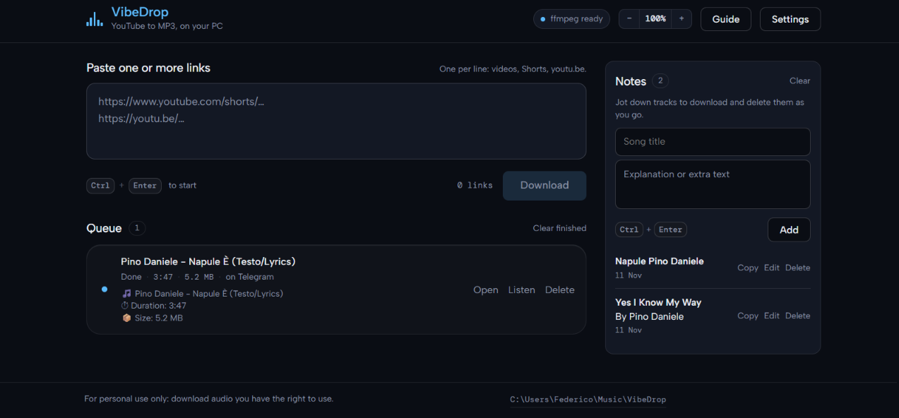

# VibeDrop

> A small, local-first music workflow for turning YouTube links into MP3 files.

<!-- Add a product screenshot here:

-->

VibeDrop runs on your own computer. Paste one or more YouTube links, download the
audio as MP3, keep a short list of songs and automatically send finished files
to your Telegram chat when a bot token and chat ID are configured. There is no
hosted service in the middle.

## What it includes

- A desktop window with a local web interface.
- YouTube videos, Shorts, live links and `youtu.be` links.
- A one-at-a-time download queue with progress, errors and playback actions.
- MP3 quality choices from 128 to 320 kbps.
- Automatic Telegram delivery through your own bot when configured.
- Song notes with titles, explanations, rename, copy and delete actions.
- English, Italian and Spanish interface languages.
- Light, dark and system theme choices.
- Local clipboard support for settings and notes.
- A built-in tutorial and automatic `yt-dlp` update checks.

## Quick start for developers

### 1. Install Python

Use Python 3.11 or newer. Confirm it is available:

```powershell
python --version
```

### 2. Download the project

```powershell
git clone https://github.com/YOUR_USERNAME/vibedrop.git
cd vibedrop
```

If you downloaded a ZIP instead, extract it and open PowerShell in the extracted
folder.

### 3. Create an isolated environment

```powershell
python -m venv .venv
.venv\Scripts\python -m pip install -r requirements.txt
```

### 4. Install FFmpeg

FFmpeg is required to create MP3 files. Put `ffmpeg.exe` in a `bin` folder next
to the project, or install FFmpeg and add it to your system `PATH`.

The app also tries `imageio-ffmpeg` when available.

### 5. Start VibeDrop

```powershell
.venv\Scripts\python run.py
```

The desktop window opens automatically. If a desktop webview is unavailable,
VibeDrop opens the same local interface in your browser.

To run only the local server:

```powershell
.venv\Scripts\python run.py --serve
```

## First use

1. Open **Settings** and choose your language and theme.
2. Paste a YouTube link into the large composer.
3. Press **Download**, or use `Ctrl+Enter`.
4. When a job is finished, use **Open** or **Listen**.
5. Add a song title and optional explanation to the Notes panel when you want
   to keep context with a track.

## Telegram delivery

1. Open Telegram and search for `@BotFather`.
2. Send `/newbot` and follow the prompts.
3. Copy the token BotFather gives you.
4. Open VibeDrop **Settings** and use **Paste** beside the token field.
5. Open your new bot, press **Start**, then use **Find chat id** in VibeDrop.
6. Use **Test connection**.
7. Save the settings. Every later MP3 is sent automatically when the token and
   chat ID are configured.

Keep the bot token private. It is stored in your local application data, or can
be supplied through `TELEGRAM_TOKEN` and `TELEGRAM_CHAT_ID`.

## Local data

VibeDrop stores settings, queue state, notes and update metadata in:

- Windows: `%APPDATA%\VibeDrop`
- macOS: `~/Library/Application Support/VibeDrop`
- Linux: `~/.config/VibeDrop`

Set `MUSIC_EXTRACTOR_HOME` to use a different data directory. This is useful for
testing or portable setups.

## Build a Windows executable

Install PyInstaller, then run:

```powershell
.venv\Scripts\python -m pip install pyinstaller
.venv\Scripts\python build.py
```

The executable is written to `dist\VibeDrop.exe`. Include `bin\ffmpeg.exe`
before building if the target computer will not have FFmpeg installed.

## Legal and responsible use

Only download audio that you have permission to use. Respect copyright, the
terms of the source service and the privacy of other people.

## Publishing

For the complete GitHub checklist, including repository creation, releases,
binary distribution and security checks, see
[GITHUB_PUBLISHING_GUIDE.md](GITHUB_PUBLISHING_GUIDE.md).
